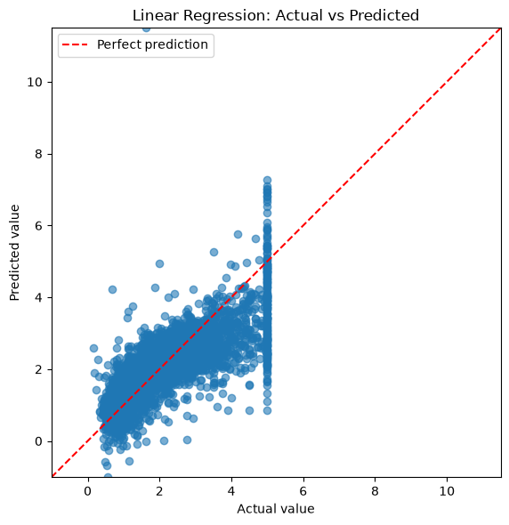
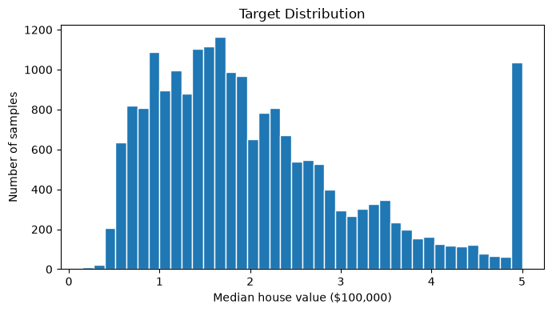
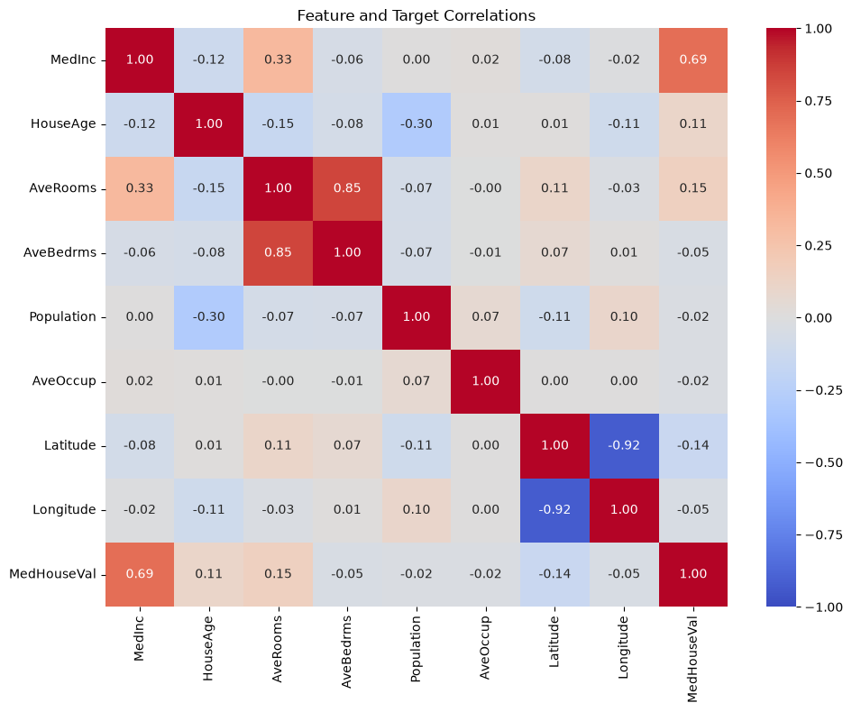

# 第 1 周实验报告

姓名：Qianyu

## 任务与目标

待填写。

## 数据与实验方法

Iris 数据数量：150
80% training
20% validation

## 实验结果

### Logistic Regression
SGD优化，lr=0.01
Accuracies:
epoch=100 | 0.70
Confusion matrix:\
[[10  0  0]\
 [ 0  1  9]\
 [ 0  0 10]]\
epoch=500 | 0.83332we43
Confusion matrix:\
[[10  0  0]\
 [ 0  5  5]\
 [ 0  0 10]]\
epoch=1000 | 0.9667
Confusion matrix:\
[[10  0  0]\
 [ 0  8  2]\
 [ 0  0 10]]\
epoch=2000 | 0.9667
Confusion matrix:\
[[10  0  0]\
 [ 0  9  1]\
 [ 0  0 10]]\

### KNN
k = 1
Test accuracy: 90.00%
Confusion matrix:\
[[10  0  0]\
 [ 0  7  3]\
 [ 0  0 10]]\

k = 3
Test accuracy: 93.33%
Confusion matrix:\
[[10  0  0]\
 [ 0  8  2]\
 [ 0  0 10]]\

k = 5
Test accuracy: 90.00%
Confusion matrix:\
[[10  0  0]\
 [ 0  7  3]\
 [ 0  0 10]]\

### Decision Tree
depth = 1
Test accuracy: 93.33%
Confusion matrix:\
[[10  0  0]\
 [ 0  8  2]\
 [ 0  0 10]]\

depth = 3
Test accuracy: 93.33%
Confusion matrix:\
[[10  0  0]\
 [ 0  8  2]\
 [ 0  0 10]]\

depth = 5
Test accuracy: 93.33%
Confusion matrix:\
[[10  0  0]\
 [ 0  8  2]\
 [ 0  0 10]]\

#### Linear Regression
MSE:  0.5559\
RMSE: 0.7456\
MAE:  0.5332\
R²:   0.5758

#### Linear Regression
MSE:  0.5559\
RMSE: 0.7456\
MAE:  0.5332\
R²:   0.5758

## 分析与结论

### Iris Classification:
Feature importances from trained decision tree:\
petal width (cm)     0.573101\
petal length (cm)    0.422382\
sepal length (cm)    0.004517\
sepal width (cm)     0.000000

Petal width is the most helpful feature for classification

### Linear Regression:

## 问题与解决过程

待填写。

## AI 辅助与引用来源

待记录工具、辅助内容、人工检查过程和外部参考。
